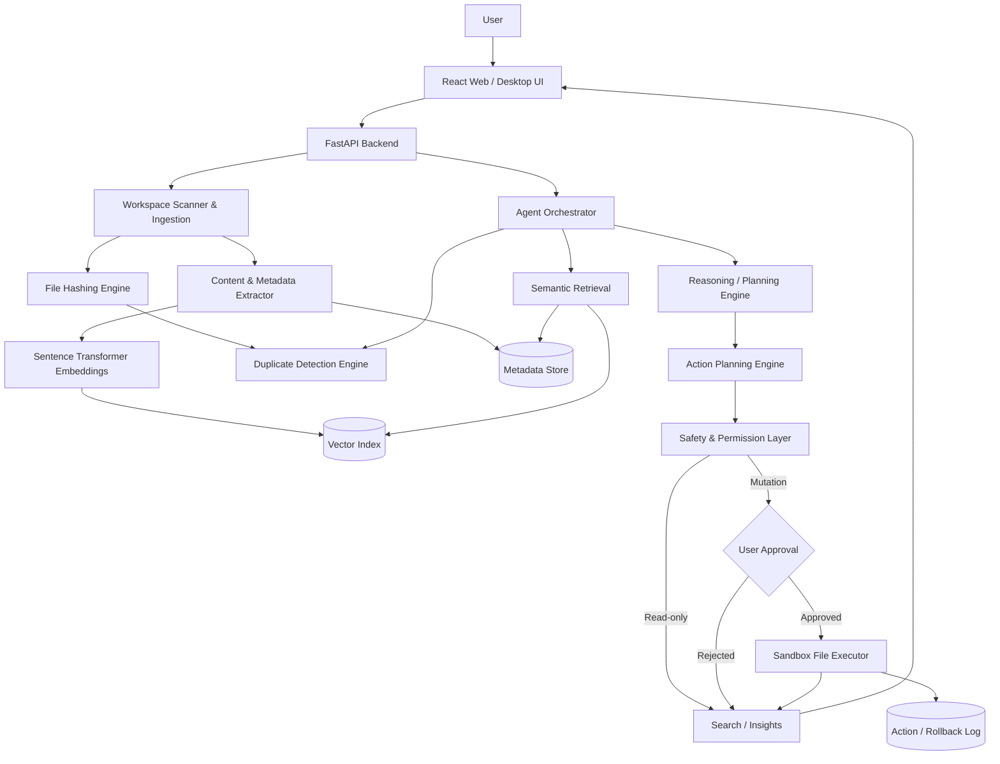

# NEXORA - AI Workspace Intelligence

NEXORA is a local-first AI workspace intelligence MVP. It demonstrates how an AI agent can ingest a sandboxed virtual workspace, understand document content, detect exact duplicates, search by semantic meaning, propose organization plans, and execute changes only after human approval.

This project is designed for an AI Engineer Associate technical application. It is not a static demo: the backend seeds real sandbox files, extracts text, computes hashes, indexes embeddings, calculates duplicate groups, generates organization actions, records activity, and supports undo for safe mutations.

## Problem

Traditional file managers understand names, folders, and timestamps. They do not understand that `notes_43.txt` might discuss transformer attention, that two invoices are exact byte-level duplicates, or that a final-year project document belongs near research notes.

## Solution

NEXORA treats a workspace as an intelligence graph:

- scan a sandboxed workspace
- extract document text and metadata
- detect exact duplicates with SHA-256
- embed document content for semantic retrieval
- classify files into practical categories
- generate organization plans from user instructions
- require approval before move, trash, rename, overwrite, or delete actions
- log approved actions and provide rollback for move/trash operations

## Features

- Demo authentication with local token persistence
- Preloaded sandbox workspace with 26 realistic messy documents
- PDF, DOCX, TXT, and MD text extraction
- SHA-256 exact duplicate detection
- Semantic search over extracted content
- Sentence Transformer support with `all-MiniLM-L6-v2`
- Deterministic lightweight embedding fallback when the model is unavailable
- File explorer with folder tree and intelligence panel
- Duplicate page with exact duplicates and related versions
- Organization planner with confidence, risk, and reasons
- Human-in-the-loop approval before mutation
- Sandbox-only executor with path traversal protection
- Trash-first duplicate cleanup
- Activity log and undo
- Render/Vercel deployment files

## Architecture



## Tech Stack

Frontend:

- React
- Vite
- TypeScript
- Tailwind CSS
- Lucide React

Backend:

- Python
- FastAPI
- Pydantic
- SQLite
- Uvicorn

AI and document intelligence:

- `sentence-transformers` with `all-MiniLM-L6-v2` when available
- NumPy cosine similarity fallback index
- PyMuPDF for PDF extraction
- python-docx for DOCX extraction
- SHA-256 hashing for exact duplicate detection

## Local Installation

### Backend

```bash
cd backend
python -m venv .venv
.venv\Scripts\activate
pip install -r requirements.txt
uvicorn app.main:app --reload --port 8000
```

The backend seeds `backend/sandbox/` on first startup. It never reads the reviewer's real filesystem.

### Frontend

```bash
cd frontend
npm install
copy .env.example .env
npm run dev
```

Set `VITE_API_URL=http://localhost:8000` for local development.

## Demo Credentials

Email: `reviewer@nexora.ai`

Password: `NexoraDemo2026!`

These are intentionally dummy credentials for the technical demo.

## Environment Variables

Backend:

- `FRONTEND_URL`: frontend origin for CORS
- `CORS_ORIGINS`: comma-separated allowed origins
- `DEMO_EMAIL`: demo login email
- `DEMO_PASSWORD`: demo login password
- `NEXORA_EMBEDDINGS_MODE`: `auto`, `lightweight`, or `sentence-transformers`

Frontend:

- `VITE_API_URL`: deployed FastAPI URL

## API Overview

- `POST /api/auth/login`
- `GET /api/workspace/stats`
- `GET /api/files`
- `GET /api/files/{id}`
- `POST /api/search`
- `GET /api/duplicates`
- `POST /api/organize/plan`
- `POST /api/organize/approve`
- `POST /api/organize/reject`
- `GET /api/activity`
- `POST /api/activity/{id}/undo`
- `GET /api/health`

## Safety Model

NEXORA operates only inside `backend/sandbox/`.

Implemented controls:

- sandbox-only path resolution
- path traversal rejection
- safe filename normalization
- file extension allowlist
- no shell execution from the app
- no arbitrary filesystem access
- explicit approval for all mutating operations
- duplicate cleanup moves files to sandbox Trash
- action history records source, destination, reason, status, and approver
- undo restores move/trash operations where possible

Critical behavior: attempting a mutating operation without approval raises a safety error and is covered by tests.

## MVP Limitations

- Demo authentication is intentionally simple and not production OAuth.
- The fallback embedding mode is deterministic and useful for demos, but less accurate than a real transformer model.
- Upload support is intentionally deferred; the preloaded workspace is the primary technical evaluation path.
- The SQLite store is local and single-user.
- The optional Ollama enhancement is not required for the hosted MVP.

## Future Roadmap

- Drag-and-drop uploads with re-indexing
- Local Ollama explanations for richer organization plans
- Visual relationship graph for file clusters
- Batch plan editing before approval
- More document formats and OCR
- Workspace snapshot/version timeline
- Team-safe review mode for shared folders

## Deployment

Backend on Render:

1. Create a Render web service using `backend/render.yaml`.
2. Set `FRONTEND_URL` and `CORS_ORIGINS` to the deployed frontend origin.
3. Keep `NEXORA_EMBEDDINGS_MODE=auto` for model fallback behavior.

Frontend on Vercel:

1. Deploy `frontend/`.
2. Set `VITE_API_URL` to the Render backend URL.
3. Build command: `npm run build`.
4. Output directory: `dist`.
